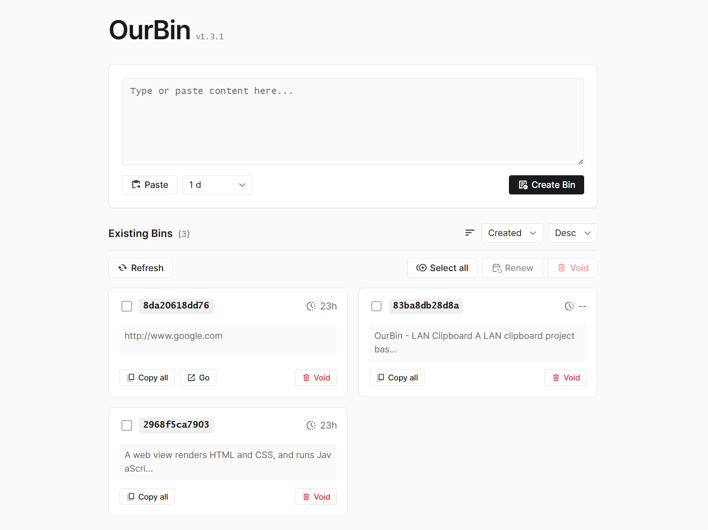

# OurBin - LAN Clipboard

> A LAN clipboard project based on Python FastAPI + SQLite, supporting creation, editing, management, and sharing of text content.



[【简体中文】](README_zh.md)

## Features

### Core Features
- ✅ Create clipboard content (supports custom expiration time, from minutes to permanent)
- ✅ Access and edit clipboard content via UUID
- ✅ Alias (name a bin instead of remembering its UUID)
- ✅ Pin important bins to the top of the list
- ✅ Soft delete functionality
- ✅ List all valid clipboard content
- ✅ Batch operations (select, delete, renew)
- ✅ Sorting functionality (by creation time, expiration time)
- ✅ Link detection with a per-link Go picker for multi-link content
- ✅ Clean up expired bins
- ✅ Database reset (with security confirmation)
- ✅ RESTful API design
- ✅ Auto-generated API documentation

### Frontend Features
- 📋 Import content from clipboard (works on plain HTTP as well)
- 🔍 Real-time search and filtering
- 📊 Display creation time and expiration time
- 🔄 Auto-refresh list
- 📝 Online content editing
- 🔗 One-click copy URL or content
- ⏰ Expiration time display
- 📌 Quick pin / unpin from the card or the detail page
- 🏷️ Aliases shown on cards, full `<alias> (<uuid>)` on the detail page
- 🎨 Settings panel: theme color, custom CSS, alert preferences, auto-pin for never-expiring bins

## Tech Stack

- **Backend**: Python 3.11+, FastAPI, SQLite
- **Frontend**: HTML5, JavaScript (Vanilla)
- **Deployment**: Docker, Docker Compose
- **Server**: Uvicorn (ASGI)

## Quick Start

### Method 1: Docker Deployment (Recommended)

1. **Clone the repository**
```bash
git clone <repository-url>
cd ourbin
```

2. **Create data directory**
```bash
mkdir -p data
```

3. **Configure port (optional)**
Create a `.env` file:
```bash
CUSTOM_PORT=8000
```

4. **Start the service**
```bash
docker-compose up -d
```

5. **View logs**
```bash
docker-compose logs -f
```

6. **Stop the service**
```bash
docker-compose down
```

The service will start at `http://localhost:8000` (or your configured port)

### Method 2: Local Run

1. **Install dependencies**
```bash
pip install -r requirements.txt
```

2. **Run the service**
```bash
python app.py
```

The service will start at `http://localhost:8000`

## API Documentation

After starting the service, you can access:
- **Swagger UI**: http://localhost:8000/docs
- **ReDoc**: http://localhost:8000/redoc

## API Endpoints

### Create Clipboard Content
```http
POST /api/bins
Content-Type: application/json

{
    "content": "Clipboard content",
    "expiration_hours": 24,  // Supports decimals, e.g., 0.083 means 5 minutes
    "alias": "My note",      // Optional
    "pinned": false          // Optional
}
```

**Response**:
```json
{
    "uuid": "4cd4a4d332cb",
    "creation_time": 1704067200,
    "content": "Clipboard content",
    "expiration_time": 1704153600,
    "alias": "My note",
    "pinned": false
}
```

### Get Clipboard Content
```http
GET /api/bins/{uuid}
```

### Update Clipboard Content
All fields are optional; only the provided ones are updated.
```http
PUT /api/bins/{uuid}
Content-Type: application/json

{
    "content": "New content",
    "alias": "New alias",   // Set to "" to clear
    "pinned": true
}
```

### Delete Clipboard Content (Soft Delete)
```http
DELETE /api/bins/{uuid}
```

Supports batch deletion, multiple UUIDs separated by commas:
```http
DELETE /api/bins/{uuid1},{uuid2},{uuid3}
```

### List All Clipboard Content
```http
GET /api/bins?sort_by=creation_time&order=desc
```

**Query Parameters**:
- `sort_by`: Sort field (`creation_time`, `expiration_time`)
- `order`: Sort order (`asc`, `desc`)

Pinned bins always come first (ordered by creation time among themselves), followed by the rest sorted as requested.

**Response**:
```json
[
    {
        "uuid": "4cd4a4d332cb",
        "creation_time": 1704067200,
        "expiration_time": 1704153600,
        "content": "Clipboard content preview...",
        "truncated": false,
        "urls": ["https://example.com"],
        "alias": "My note",
        "pinned": true
    }
]
```

### Batch Renew (Add 1 Day)
```http
PUT /api/bins/renew
Content-Type: application/json

{
    "uuids": ["uuid1", "uuid2", "uuid3"]
}
```

### Clean Up Expired Bins
```http
DELETE /api/bins/cleanup
```

Deletes all records where `expiration_time <= current_time`.

### Reset Database
```http
DELETE /api/bins/reset
```

⚠️ **Warning**: This operation will delete all data!

### Health Check
```http
GET /api/health
```

**Response**:
```json
{
    "status": "healthy",
    "version": "1.4.1"
}
```

## Database Schema

```sql
CREATE TABLE bins (
    id INTEGER PRIMARY KEY AUTOINCREMENT,
    uuid TEXT UNIQUE NOT NULL,
    creation_time INTEGER NOT NULL,
    content TEXT NOT NULL,
    file_path TEXT,
    expiration_time INTEGER NOT NULL,
    alias TEXT,
    pinned INTEGER NOT NULL DEFAULT 0
);
```

Existing databases are migrated automatically at startup (`alias` / `pinned` columns are added on demand).

## Environment Variables

| Variable | Description | Default |
|----------|-------------|---------|
| `DB_PATH` | Database file path | `ourbin.db` |
| `PORT` | Service port | `8000` |
| `CUSTOM_PORT` | Docker mapped port | `8000` |

## Data Persistence

### Docker Deployment
Database file is saved in `./data/ourbin.db`, persisted through Docker volume mount. Data will be preserved even if the container is deleted and recreated.

### Local Deployment
Database file is saved in `ourbin.db` in the project root directory (or the path specified by the `DB_PATH` environment variable).

## Frontend Usage

### Main Page (`index.html`)
- Create new bins (optional alias, pin-on-create)
- View all bin list
- Select, delete, renew bins
- Sort and filter
- Import content from clipboard (Paste / Clear buttons inside the editor)
- Quick pin / unpin from a bin card
- One-click Go for link content, per-link picker for multiple links

### Bin Detail Page (`bin.html`)
- View complete bin content
- Edit and save content
- Edit the alias (shown as `<alias> (<uuid>)`, the raw URL keeps using the UUID)
- Pin / unpin
- Copy URL or content

### Settings
Open settings via the gear icon at the top right:
- **Alert**: toggle the copy confirmation and the void confirmation dialogs
- **Behavior**: auto-pin never-expiring bins (off by default)
- **Customization**: theme color and custom CSS (overrides built-in styles)
- **Danger Zone**: cleanup and reset tools (also holds the version number)

## Expiration Time Notes

- Supports minute-level precision (e.g., 5 minutes = 0.083 hours)
- Setting to `-1` means never expires (actually set to a date far in the future)
- Bins with expiration time over 1 year display as `--` or `Never` in the interface

## Development

### Project Structure
```
ourbin/
├── app.py              # FastAPI application
├── index.html          # Main page
├── bin.html            # Bin detail page
├── index.js            # Main page logic
├── bin.js              # Detail page logic
├── settings.js         # Settings (localStorage) & theme / custom CSS
├── clipboard.js        # Clipboard helpers (with non-HTTPS fallback)
├── msr.woff2           # Icon font
├── requirements.txt    # Python dependencies
├── Dockerfile          # Docker image definition
├── docker-compose.yml  # Docker Compose configuration
└── README.md           # Project documentation
```

### Local Development
```bash
# Install dependencies
pip install -r requirements.txt

# Run the service
python app.py

# Access frontend
# Open http://localhost:8000 (served by the app itself)
```

## License

MIT License

## Contributing

Issues and Pull Requests are welcome!


